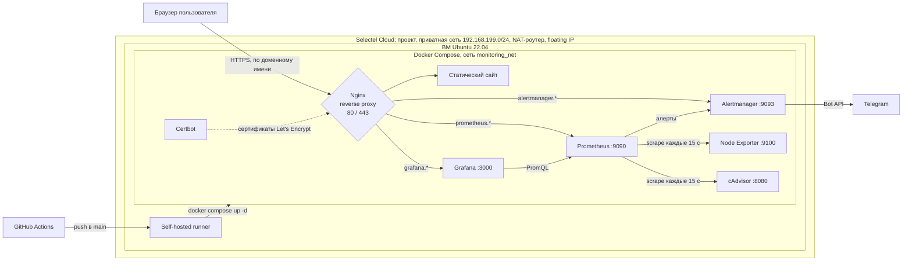

# witcher3-host

Учебный pet-проект: облачная инфраструктура в Selectel, развёрнутая через Terraform, со стеком мониторинга, HTTPS и автоматическим деплоем через GitHub Actions.

На сервере работает статический сайт и веб-интерфейсы мониторинга. Nginx принимает весь входящий трафик и по доменному имени направляет запрос в нужный контейнер. Prometheus собирает метрики хоста и контейнеров, Grafana их показывает, а Alertmanager при сбое шлёт уведомление в Telegram.

> **Статус:** проект работал в Selectel с июня по август 2026 года. Сейчас инфраструктура удалена (`terraform destroy`), чтобы не платить за простаивающие ресурсы. Код и документация сохранены, всё разворачивается заново по инструкции ниже.

## Стек

| Область | Инструменты |
|---|---|
| Инфраструктура как код | Terraform (провайдеры `selectel` и `openstack`) |
| Облако | Selectel Cloud (OpenStack), регион ru-9 |
| ОС | Ubuntu 22.04 LTS |
| Контейнеризация | Docker, Docker Compose v2 |
| Веб-сервер | Nginx (reverse proxy), Let's Encrypt (Certbot, webroot) |
| Мониторинг | Prometheus, Grafana, Node Exporter, cAdvisor |
| Алертинг | Alertmanager → Telegram-бот |
| CI/CD | GitHub Actions (self-hosted runner), GitHub Secrets |

## Архитектура



**Как проходит запрос.** Все DNS-записи (`@`, `www`, `grafana`, `prometheus`, `alertmanager`) указывают на один публичный IP. Nginx смотрит на заголовок `Host` и проксирует запрос в нужный контейнер по его имени внутри Docker-сети. Наружу опубликованы только порты Nginx (80 и 443).

## Структура репозитория

```
.
├── .github/workflows/deploy.yml        # пайплайн деплоя
└── project/
    ├── terraform/
    │   ├── main.tf                     # сеть, роутер, ВМ, диск, floating IP
    │   └── variables.tf                # переменные (значения в terraform.tfvars, не в Git)
    ├── docker/
    │   ├── docker-compose.yml          # все сервисы
    │   ├── html/                       # статический сайт
    │   └── configs/
    │       ├── nginx/nginx.conf
    │       ├── prometheus/             # prometheus.yml, alerts.yml
    │       ├── alertmanager/           # alertmanager.example.yml (боевой генерируется в CI)
    │       └── certbot/                # сертификаты (в .gitignore)
    ├── .gitlab-ci.yml                  # первая версия пайплайна, до переезда на GitHub Actions
    └── .gitignore
```

## Как развернуть

### 1. Инфраструктура (Terraform)

Terraform создаёт в Selectel:
- отдельный проект и сервисного пользователя с ролью `member`;
- приватную сеть и подсеть `192.168.199.0/24`;
- облачный роутер с выходом в интернет (NAT);
- сетевой порт, загрузочный сетевой диск 20 ГБ и ВМ (1 vCPU, 1 ГБ RAM);
- floating IP, привязанный к порту ВМ.

В Selectel используются два провайдера: `selectel` управляет аккаунтом (проекты, пользователи, ключи), а `openstack` управляет ресурсами внутри проекта (сети, диски, ВМ).

Создайте `project/terraform/terraform.tfvars` (файл в `.gitignore`):

```hcl
sel_domain                   = "<номер аккаунта Selectel>"
sel_username                 = "<пользователь панели>"
sel_password                 = "<пароль>"
sel_service_account_username = "<имя сервисного пользователя>"
sel_service_account_password = "<пароль сервисного пользователя>"
```

Затем:

```bash
cd project/terraform
terraform init
terraform plan
terraform apply      # в конце выведет public_ip_address
```

### 2. Домен и DNS

В DNS-хостинге Selectel создаются A-записи `@`, `www`, `grafana`, `prometheus` и `alertmanager` на публичный IP сервера. Для зоны `.ru` домен делегируется только после подтверждения телефона владельца. Статус можно проверить так:

```bash
whois <домен>    # нужно: state: REGISTERED, DELEGATED, VERIFIED
```

### 3. Базовая защита сервера

- создан непривилегированный пользователь с `sudo`;
- вход только по SSH-ключу;
- в `/etc/ssh/sshd_config` заданы `PermitRootLogin no` и `PasswordAuthentication no`.

После изменения `sshd_config` текущую root-сессию не закрываем, пока не проверим вход под новым пользователем во втором окне. Иначе можно потерять доступ к серверу.

### 4. Docker

```bash
sudo apt update
sudo apt install -y docker.io docker-compose-v2
sudo usermod -aG docker $USER    # затем перелогиниться
```

### 5. HTTPS

Сертификат Let's Encrypt выпускается Certbot'ом через webroot: Certbot кладёт проверочный файл в общий том, а Nginx отдаёт его по пути `/.well-known/acme-challenge/`.

На старте сертификатов ещё нет, а Nginx с `listen 443 ssl` без них не запустится. Поэтому сначала Nginx поднимается с HTTP-конфигом, затем выпускается сертификат, и только потом включается HTTPS-конфиг из репозитория:

```bash
docker compose run --rm certbot certonly --webroot --webroot-path /var/www/certbot/ \
  -d <домен>,www.<домен>,grafana.<домен>,prometheus.<домен>,alertmanager.<домен>
```

Перед настоящим выпуском удобно проверить пути с флагом `--dry-run`.

В итоговом конфиге порт 80 обслуживает только ACME challenge и `301` редирект на HTTPS, а вся работа идёт через 443.

### 6. CI/CD

1. На сервере установлен GitHub Actions runner и запущен как systemd-сервис (`./svc.sh install && ./svc.sh start`).
2. В **Settings → Secrets and variables → Actions** заданы секреты:
   - `PROD_ENV`: содержимое `.env` для Docker Compose (логин и пароль Grafana);
   - `TG_BOT_TOKEN`, `TG_CHAT_ID`: доступ бота к чату для алертов.
3. При каждом push в `main` пайплайн:
   - забирает код;
   - создаёт `.env` и `alertmanager.yml` из секретов (в репозитории их нет);
   - копирует сертификаты в рабочую папку runner'а;
   - перезапускает стек командой `docker compose up -d`.

### 7. Проверка алертинга

```bash
docker stop nginx
```

Примерно через минуту в Telegram приходит `🚨 СБОЙ: NginxContainerDown`, а после `docker start nginx` приходит сообщение о восстановлении.

## Мониторинг

- **Node Exporter** собирает метрики хоста: CPU, память, диск, сеть. В Grafana для них импортирован дашборд [Node Exporter Full](https://grafana.com/grafana/dashboards/1860) (ID 1860).
- **cAdvisor** собирает метрики контейнеров.
- **Prometheus** опрашивает обе цели каждые 15 секунд и проверяет правила из `alerts.yml`.
- **Правило `NginxContainerDown`** срабатывает, если cAdvisor не видел контейнер `nginx` больше 60 секунд или метрика пропала совсем (`absent`).

## Решения и проблемы, с которыми столкнулся

**Сетевой порт ВМ создаётся отдельно от самой ВМ.** IP-адреса привязаны к порту, поэтому при пересоздании ВМ внутренний и публичный адреса не меняются. Для диска и ВМ задан `ignore_changes = [image_id]`: иначе при выходе нового образа Ubuntu Terraform попытался бы пересоздать диск.

**Запасной доступ к Prometheus.** Чтобы метрики оставались доступны, даже если Nginx упал, порт 9090 опубликован, но только на `127.0.0.1`. Из интернета он закрыт, а зайти можно через SSH-туннель: `ssh -L 9090:localhost:9090 <user>@<ip>`.

**Секреты не хранятся в Git.** `terraform.tfvars`, `.env`, `alertmanager.yml` и сертификаты добавлены в `.gitignore`. Боевой `alertmanager.yml` собирается в пайплайне из GitHub Secrets, а в репозитории лежит только шаблон `alertmanager.example.yml`. В одном из первых коммитов токен бота всё же попал в историю. Токен был отозван, а вывод из этого простой: секреты только через Secrets и проверка `git diff` перед коммитом.

**Telegram API недоступен напрямую с сервера в РФ.** Alertmanager отправлял запросы через HTTP-прокси на зарубежном VPS (`http_config.proxy_url` в шаблоне).

**Время в уведомлениях.** Alertmanager по умолчанию работает в UTC. Чтобы время в сообщениях было московским, в контейнер передан `TZ=Europe/Moscow` и смонтирован `/usr/share/zoneinfo`.

**Free и Available в Grafana.** Показатель Free в Linux почти всегда близок к нулю, потому что ядро держит в памяти файловый кэш (page cache). Реальный запас памяти показывает Available: кэш ядро может освободить в любой момент.

**cAdvisor и blackbox exporter.** Пробовал заменить cAdvisor на blackbox exporter, затем вернул cAdvisor для проверки состояния контейнеров.

**Переезд CI с GitLab на GitHub Actions.** Первая версия пайплайна была на GitLab CI (`.gitlab-ci.yml` оставлен для истории), затем пайплайн перенесён в GitHub Actions.

### Траблшутинг пайплайна

**Папки-призраки от Docker.** Ошибка: `Are you trying to mount a directory onto a file?`. Причина: если файла для bind mount нет (например, конфиг из `.gitignore` не появился в рабочей папке), Docker создаёт на его месте пустую директорию от root. Решение: генерировать файл в пайплайне до запуска compose и удалить ошибочно созданную директорию.

**`EACCES: permission denied` на шаге checkout.** Сертификаты копировались через `sudo cp` и становились собственностью root, а при следующем запуске `actions/checkout`, работающий от обычного пользователя, не мог их удалить. Решение: сразу после копирования возвращать владельца через `chown`.

**`No such file or directory` в шагах пайплайна.** Шаги стартуют из корня репозитория, поэтому пути должны начинаться с `project/docker/...`. Workflow-файл тоже должен лежать строго в `.github/workflows/` в корне репозитория, иначе GitHub его не видит.

## Известные ограничения и что можно улучшить

| Ограничение | Что можно сделать |
|---|---|
| Prometheus и Alertmanager доступны по поддоменам без авторизации | Basic auth в Nginx или доступ только через VPN/SSH-туннель |
| Runner'у выданы `NOPASSWD` права на `cp` и `chown`, что фактически равно root | Не копировать сертификаты, а монтировать их в контейнер напрямую с хоста |
| Нет автопродления сертификатов (Let's Encrypt выдаёт их на 90 дней) | `certbot renew` по таймеру и `nginx -s reload` |
| Образы с тегом `latest` | Зафиксировать версии образов |
| Алерт только на падение Nginx | Добавить правила на `up == 0`, место на диске, память, перезапуски контейнеров |
| Пайплайн генерирует `alertmanager.yml` без прокси и шаблона сообщения из `alertmanager.example.yml` | Хранить в Git шаблон и подставлять в него секреты (`envsubst`) |
| Docker и hardening настраиваются вручную | Вынести настройку сервера в Ansible или cloud-init |
| Terraform state хранится локально | Remote state в S3 Selectel |
